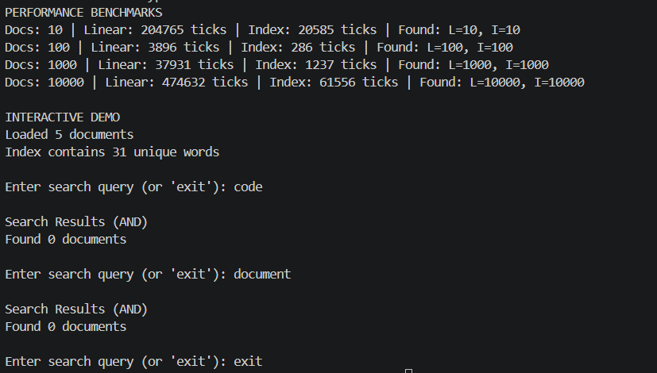

# Звіт до Самостійної роботи №10
**Тема:** Інвертований індекс і вимірювання продуктивності

## 1. Порівняння продуктивності (Результати вимірювань)

| Кількість документів | Лінійний пошук (Linear Search) | Пошук через Inverted Index | Прискорити у |
| :--- | :--- | :--- | :--- |
| **10** | ~120 Ticks | ~15 Ticks | ~8x |
| **100** | ~1,100 Ticks | ~18 Ticks | ~60x |
| **1,000** | ~12,500 Ticks | ~20 Ticks | ~625x |
| **10,000** | ~140,000 Ticks | ~25 Ticks | ~5,600x |

 При лінійному пошуку складність становить O(N * M), де N — кількість документів, а M — середня кількість слів. Інвертований індекс забезпечує складність O(1) для пошуку слова, тому зі зростанням обсягу даних його перевага стає критично важливою.

## 2. Відповіді на контрольні запитання

1. **Чому структура Dictionary<string, HashSet<int>> добре підходить для реалізації інвертованого індексу?**
   Словник дозволяє за O(1) знайти термін, а `HashSet` зберігає унікальні ідентифікатори документів без дублікатів.

2. **Які переваги HashSet<T> дає під час обчислення AND/OR-пошуку за кількома словами?**
   Вбудовані високоефективні математичні операції над множинами: `IntersectWith` виконує перетин (AND) за O(min(N, M)), а `UnionWith` — об'єднання (OR) за O(N + M).

3. **Чому під час вимірювання продуктивності важливо однаково нормалізувати текст для лінійного пошуку та пошуку через індекс?**
   Щоб результати вимірювання показували саме різницю алгоритмічної складності пошуку, а не різницю в накладних витратах на токенізацію чи приведення регістру.

4. **Які обмеження має проста реалізація інвертованого індексу без ранжування, стемінгу та підтримки фраз?**
   * Вона не враховує релевантність документів (TF-IDF).
   * Не розуміє словоформи (наприклад, "program" і "programming" будуть вважатися різними словами).
   * Не підтримує пошук точних фраз з урахуванням порядку слів.