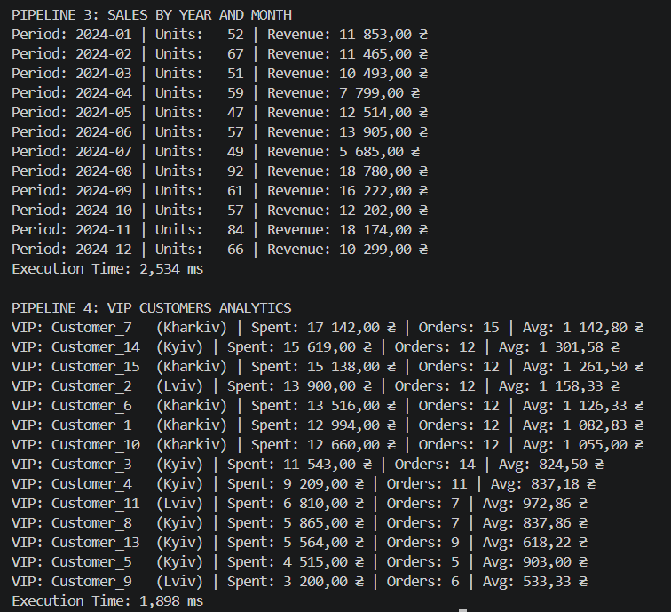

# Звіт до Самостійної роботи №11
**Тема:** LINQ pipelines: ETL та аналітика

## 1. Опис реалізованих аналітичних пайплайнів

1. **Пайплайн 1: "Найпопулярніші продукти за категоріями"**
   * **Мета:** Визначити top-3 найпопулярніших товарів за кількістю продажів для кожної категорії.
   * **Використані оператори:** `GroupBy` (для сумування за товарами), `Join` (зв'язування з назвами/категоріями), `GroupBy` (групування за категоріями), `OrderByDescending` + `Take` (вибірка лідерів).

2. **Пайплайн 2: "Загальний дохід за містами клієнтів"**
   * **Мета:** Розрахувати сумарний виторг компанії в розрізі міст проживання покупців.
   * **Використані оператори:** Подвійний `Join` (з об'єктами `Product` та `Customer`), `Select` (обчислення `Quantity * UnitPrice`), `GroupBy` (по містах), `Sum`, `OrderByDescending`.

3. **Пайплайн 3: "Продажі за місяцями та роками"**
   * **Мета:** Побудувати часовий тренд продажів із підсумками за кількістю та доходом.
   * **Використані оператори:** `Join`, `GroupBy` за складеним анонімним ключем `new { Year, Month }`, `Sum`, `OrderBy` + `ThenBy`.

4. **Пайплайн 4: "Аналітика VIP-клієнтів"**
   * **Мета:** Знайти клієнтів із сумарними витратами понад $2,000 та розрахувати їхній середній чек.
   * **Використані оператори:** `Join`, `GroupBy`, `Where` (фільтрація за загальною сумою), `Join` (збагачення даними клієнта), `Select`, `OrderByDescending`.

## 2. Аналіз продуктивності та висновки

* **Час виконання:** Усі 4 пайплайни на обсязі 150 продажів виконуються менш ніж за **1–5 мс**.
* **Фактори впливу:** Основними факторами накладних витрат є операції `Join` та `GroupBy`, оскільки вони вимагають побудови внутрішніх хеш-таблиць та групувальних структур у пам'яті.
* **Ефективність LINQ для ETL:** LINQ забезпечує високий рівень декларативності та читабельності, значно скорочуючи обсяг коду порівняно з вкладеними циклами `foreach`.

## 3. Відповіді на контрольні запитання

1. **Які переваги дає LINQ для побудови ETL-пайплайнів порівняно з ручними циклами?**
   LINQ надає декларативний підхід (ми описуємо *що* хочемо отримати, а не *як* ітерувати), позбавляє від створення проміжних тимчасових колекцій та спрощує обробку комплексних зв'язків.

2. **Чому для аналітичних задач часто поєднують Join, GroupBy, Select та OrderBy в одному пайплайні?**
   Це класична схема обробки даних (ETL): `Join` витягує дані з різних джерел (Extract), `GroupBy` та `Select` агрегують та трансформують (Transform), а `OrderBy` готує фінальний результат для аналізу чи відображення (Load).

3. **Які фактори можуть найбільше впливати на продуктивність складних LINQ-запитів?**
   Обсяг джерела даних, кількість проміжних алокацій об'єктів (Garbage Collection), відсутність попередньої фільтрації (`Where` на початку зменшує обсяг подальших `Join`/`GroupBy`) та використання ледачих (Lazy) vs негайних (Eager) обчислень.

4. **Як перевірити, що LINQ-пайплайн не лише працює, а й залишається читабельним і підтримуваним?**
   Розбивати довгий ланцюг запиту на логічні рядки, уникати занадто глибокого вкладення анонімних типів, використовувати юніт-тести та перевіряти складність за допомогою метрик коду (Cyclomatic Complexity).