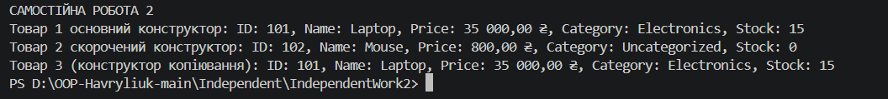

# Звіт до Самостійної роботи №2
**Тема:** Перевантаження конструкторів: приклади та сценарії

## 1. Реалізація класу `Product`
* Приватні `readonly` поля `_id`, `_name`, `_price`, `_category` і `_stockCount` зберігають характеристики товару. Публічні властивості доступні лише для читання.
* **Основний конструктор** приймає всі характеристики товару.
* **Скорочений конструктор** приймає `id`, `name` і `price`, а через `this(...)` задає категорію `"Uncategorized"` та залишок `0`.
* **Конструктор копіювання** отримує інший `Product` і передає його значення основному конструктору через `this(...)`.
* Перевизначений `ToString()` повертає рядок із повною інформацією про товар.

## 2. Демонстрація роботи
* У `Main` створюються товар із повними даними, товар зі скороченим набором даних і копія першого товару.
* Інформація про всі три об'єкти виводиться в консоль із позначенням використаного конструктора.

## 3. Відповіді на контрольні запитання
1. **Навіщо потрібне перевантаження конструкторів у класі `Product`?**
   Щоб створювати товар із різним обсягом доступних даних.
2. **Чому конструктор копіювання зручно реалізовувати через `this(...)`?**
   Він повторно використовує основний конструктор і не дублює ініціалізацію полів.
3. **Які переваги має read-only доступ до властивостей?**
   Він не дозволяє змінити характеристики товару через публічний інтерфейс після створення об'єкта.
4. **Коли перевизначення `ToString()` спрощує налагодження та демонстрацію?**
   Коли потрібно вивести стан об'єкта у зрозумілому текстовому форматі, наприклад у консолі чи журналі.
