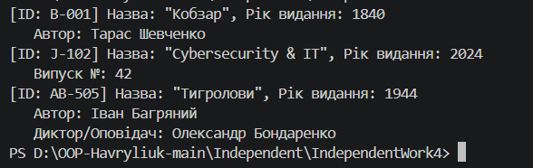

# Звіт до Самостійної роботи №4
**Тема:** Розширення ієрархії та наслідки змін базового класу

## 1. Аналіз внесення змін до базового класу
* **Внесені зміни:** Після додавання поля `_uniqueId` та відповідної властивості `UniqueId` до базового класу `LibraryItem`, конструктор `LibraryItem` почав вимагати параметр `uniqueId`.
* **Причина необхідності змін у похідних класах:** У C# конструктори не успадковуються неявно. Оскільки конструктор за замовчуванням у `LibraryItem` зник, класи `Book` та `Journal` перестали компілюватися. Довелося оновити конструктори похідних класів, додавши параметр `uniqueId` та передавши його в `base(...)`.

## 2. Переваги та недоліки наслідування
* **Переваги:**
  * Повторне використання коду (поля `Title`, `PublicationYear` та метод `DisplayDetails` не дублюються).
  * Поліморфізм (можливість зберігати всі елементи в `List<LibraryItem>`).
* **Недоліки:**
  * Проблема "крихкого базового класу" (Fragile Base Class Problem): зміна конструктора базового класу викликала необхідність редагувати всі похідні класи.
  * Сильне зв'язування (Tight Coupling) між базовим та похідними класами.

## 3. Відповіді на контрольні запитання
1. **Як зміна конструктора базового класу вплинула на похідні класи?**
   Призвела до помилок компіляції та вимагала оновлення сигнатур конструкторів і викликів `base(...)` у `Book` та `Journal`.
2. **Чим відрізняється розширення ієрархії через новий похідний клас від модифікації базового класу?**
   Додавання `AudioBook` є безпечним розширенням за принципом OCP (Open/Closed Principle). Модифікація `LibraryItem` змінює фундамент і вимагає рефакторингу всього ланцюга успадкування.
3. **У яких випадках для цієї задачі композиція могла б бути кращою за наслідування?**
   Якщо елемент бібліотеки може одночасно мати аудіо-версію, друковану та електронну версії. Тоді краще використовувати композицію (додавання компонентів `AudioTrack`, `PdfFile` до класу `Book`).
4. **Як поліморфний виклик `DisplayDetails()` допомагає перевірити правильність ієрархії?**
   Він підтверджує, що при ітерації по колекції `List<LibraryItem>` викликається саме специфічна реалізація перевизначеного методу для кожного конкретного об'єкта.