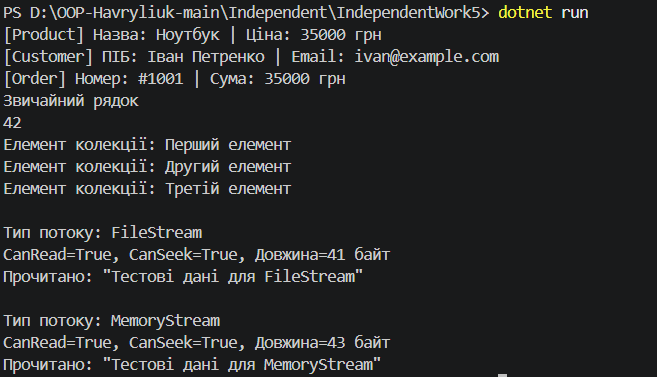

# Звіт до Самостійної роботи №5
**Тема:** Приклади поліморфізму в .NET

## 1. Прояв поліморфізму у досліджених сценаріях
1. **System.Object (`ToString()`):** Усі класи неявно успадковуються від `Object`. Збереження об'єктів у `List<object>` дозволяє поліморфно викликати перевизначений `ToString()` для кожного об'єкта під час виконання.
2. **Інтерфейс `IEnumerable<T>`:** Забезпечує уніфікований контракт перебору через `foreach`. Клієнтському коду не важливо, як саме `MyCustomCollection` зберігає дані всередині.
3. **Абстрактний клас `Stream`:** Метод `ProcessStream(Stream stream)` працює з абстракцією. Він може приймати як `FileStream`, так і `MemoryStream`, викликаючи відповідні реалізації методів `Read()` та `Seek()`.

## 2. Переваги поліморфізму
* Гнучкість та розширюваність коду.
* Зменшення дублювання коду.
* Дотримання принципу інверсії залежностей (DIP).

## 3. Відповіді на контрольні запитання
1. **Як поліморфізм проявляється при роботі з `List<object>`?**
   Елементи зберігаються під типом `object`, але під час виконання виклики віртуальних методів перенаправляються до конкретних типів.
2. **Що потрібно реалізувати в `MyCustomCollection`, щоб її можна було перебирати через `foreach`?**
   Необхідно реалізувати інтерфейс `IEnumerable<T>` та метод `GetEnumerator()`.
3. **Чому метод `ProcessStream(Stream stream)` є прикладом поліморфної роботи з абстрактним класом?**
   Тому що він приймає базовий абстрактний тип `Stream` і працює з будь-яким його нащадком без знання деталей його реалізації.
4. **Які переваги дає єдиний інтерфейс роботи для різних типів потоків і колекцій?**
   Дозволяє писати універсальний код обробки, який не потребує змін при додаванні нових джерел даних чи типів колекцій.