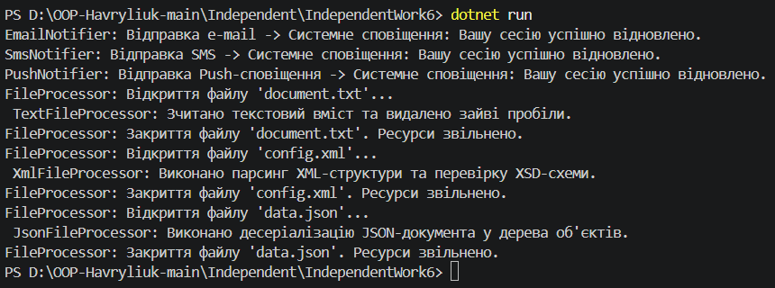

# Звіт до Самостійної роботи №6
**Тема:** Інтерфейс vs абстрактний клас: практичні критерії

## 1. Аналіз та обґрунтування сценаріїв

### Сценарій 1: Система сповіщень
* **Обраний підхід:** Інтерфейс `INotifier`.
* **Обґрунтування:** Канали сповіщень (`Email`, `SMS`, `Push`) не мають спільного стану або спільної реалізації коду. Використання інтерфейсу дає слабке зв'язування та дозволяє уникнути обмежень єдиного наслідування.

### Сценарій 2: Обробка файлів
* **Обраний підхід:** Абстрактний клас `FileProcessor`.
* **Обґрунтування:** Усі обробники файлів мають спільний стан (`FilePath`) та спільні кроки відкриття/закриття файлу (`OpenFile`, `CloseFile`). Це дозволяє реалізувати паттерн **Template Method (Шаблонний метод)**, уникаючи дублювання коду.

## Практичні критерії вибору

 Критерій | Інтерфейс | Абстрактний клас |
 :--- | :--- | :--- |
 **Спільний код / Стан** | Відсутній | Реалізує спільні методи та поля |
 **Зв'язок між типами** | Роль / Поведінка | Сутність ("is-a") |
 **Множинність** | Можна реалізувати кілька | Можна успадкувати лише один |

## 3. Відповіді на контрольні запитання
1. **Які ознаки підказують, що сценарій краще моделювати через інтерфейс?**
   Відсутність спільного стану/реалізації та потреба додати поведінку для непов'язаних між собою класів.
2. **У чому перевага абстрактного класу для процесів зі спільними кроками виконання?**
   Запобігає дублюванню однакових кроків алгоритму у кожному похідному класі (Template Method).
3. **Як порівняння двох підходів допомагає прийняти архітектурне рішення?**
   Запобігає створенню занадто жорстких ієрархій класів або дублюванню коду через необдуманий вибір.
4. **Яку роль у ваших прикладах відіграє поліморфізм?**
   Дозволяє обробляти різні класи сповіщень чи обробники файлів через їхні спільні базові типи у списках та циклах.