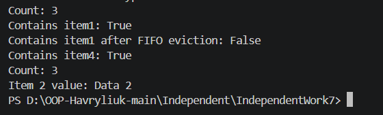

# Звіт до Самостійної роботи №7
**Тема:** Узагальнений кеш Cache<TKey, TValue> із тестами (FIFO)

## 1. Опис реалізації політики FIFO
Узагальнений клас `Cache<TKey, TValue>` поєднує дві структури даних:
* `Dictionary<TKey, TValue>` — для забезпечення пошуку та доступу до значень за ключем за час O(1).
* `Queue<TKey>` — для відстеження точного порядку додавання ключів (First In, First Out).

При досягненні граничної ємності (`_capacity`) виклик `Add` вилучає найстаріший ключ з голови черги за допомогою `_keysOrder.Dequeue()` і видаляє відповідний запис зі словника `_cache.Remove(oldestKey)`.

## 2. Відповіді на контрольні запитання

1. **Які переваги надає Cache<TKey, TValue> порівняно з окремими неузагальненими реалізаціями кешу?**
   * **Строга типізація (Type Safety):** помилки виявляються під час компіляції, а не виконання.
   * **Продуктивність:** відсутність операцій упакування/розпакування (boxing/unboxing) для значущих типів (Value Types).
   * **Універсальність:** можливість використання з будь-якими типами ключів і значень без дублювання коду.

2. **Чому для реалізації політики FIFO зручно поєднувати Dictionary<TKey, TValue> з Queue<TKey> або LinkedList<TKey>?**
   * `Dictionary` забезпечує точковий доступ до даних за константний час O(1).
   * `Queue` гарантує строгий порядок FIFO та видалення найстарішого елемента за O(1) без необхідності сканування всього кешу.

3. **У яких випадках метод Get повинен викидати KeyNotFoundException, а коли доцільніше використовувати підхід на кшталт TryGetValue?**
   * `KeyNotFoundException` доцільно викидати, коли відсутність ключа є аномальною ситуацією (порушенням контракту викликаючого коду).
   * `TryGetValue` є кращим варіантом, коли відсутність значення в кеші є нормальною ситуацією (mis/cache miss), що уникає створення високого навантаження через винятки.

4. **Які тести є критично важливими для перевірки політики витіснення елементів з кешу?**
   * Перевірка переповнення ємності: витіснення саме першого доданого ключа при додаванні N+1 елемента.
   * Перевірка збереження коректного `Count` після видалення елемента.
   * Перевірка спроби доступу до вже витісненого ключа (має повертати `false` в `ContainsKey` або викидати `KeyNotFoundException`).