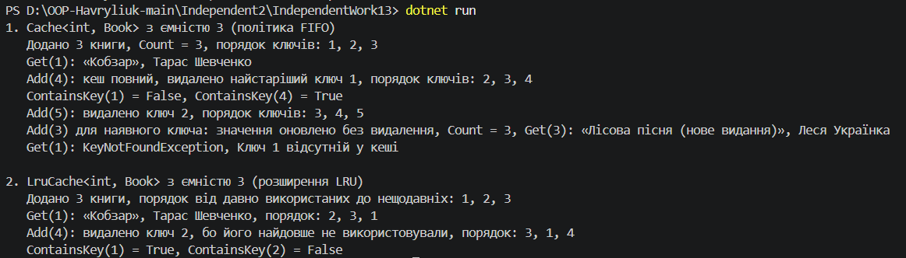

# Звіт до Самостійної роботи №13
**Тема:** Узагальнений кеш Cache<TKey, TValue> із тестами

## 1. Структура рішення
* **IndependentWork13** — консольний проєкт з класами `Cache<TKey, TValue>` (політика FIFO), `LruCache<TKey, TValue>` (розширення LRU), записом `Book` для демонстрації та методом `Main`.
* **IndependentWork13.Tests** — проєкт xUnit-тестів з посиланням на основний проєкт (`ProjectReference`). Запуск тестів: `dotnet test` у папці `IndependentWork13.Tests`.

## 2. Реалізація Cache<TKey, TValue> (FIFO)
* Приватні поля: `_capacity` (максимальна кількість елементів), `_cache` (`Dictionary<TKey, TValue>` для зберігання пар ключ-значення) і `_keysOrder` (`Queue<TKey>`, у якій ключі стоять у порядку додавання).
* Конструктор перевіряє, що ємність більша за нуль, інакше викидає `ArgumentOutOfRangeException`.
* `Add` додає нову пару. Якщо кеш заповнений, метод виймає з черги найстаріший ключ (`Dequeue`) і видаляє його зі словника. Якщо ключ уже є в кеші, оновлюється тільки значення, а його місце в черзі не змінюється.
* `Get` шукає значення через `TryGetValue` і сам викидає `KeyNotFoundException` з поясненням, якщо ключа немає.
* `ContainsKey` і `Count` працюють через словник за O(1). Додатково є властивість `Keys`, яка показує порядок ключів від найстарішого до найновішого.

## 3. Розширення LRU
`LruCache<TKey, TValue>` замість черги використовує `LinkedList<TKey>`. Кожне звернення через `Get` або повторний `Add` переносить ключ у кінець списку, тому при переповненні видаляється перший ключ, тобто той, яким найдовше не користувалися. Перенесення ключа коштує O(n), бо `LinkedList.Remove(key)` шукає вузол перебором. Для невеликої ємності це не помітно, а у великих кешах у словнику зберігають одразу вузол списку, щоб видаляти його за O(1).

## 4. Юніт-тести
Тести `CacheTests` перевіряють:
* додавання елемента та його отримання;
* `Get` для наявного ключа, а також `KeyNotFoundException` для відсутнього ключа та порожнього кешу;
* видалення найстарішого елемента при переповненні, порядок видалення після кількох переповнень і те, що читання через `Get` не рятує найстаріший елемент від видалення (це відрізняє FIFO від LRU);
* оновлення значення наявного ключа без видалення інших елементів;
* `ContainsKey`;
* `Count` для нового кешу, після додавання та те, що він ніколи не перевищує ємність;
* виняток конструктора для нульової та від'ємної ємності.

Тести `LruCacheTests` перевіряють, що при переповненні видаляється елемент, яким найдовше не користувалися, а `Get` і повторний `Add` переносять ключ у кінець.

## 5. Результат виконання

## 6. Відповіді на контрольні запитання

1. **Які переваги надає Cache<TKey, TValue> порівняно з окремими неузагальненими реалізаціями кешу?**
   Один клас працює з будь-якими типами ключів і значень: у демонстрації це `int` і `Book`, а в тестах `string` та `int`. Компілятор перевіряє типи, тому не потрібні приведення з `object` і немає упакування значущих типів.

2. **Чому для реалізації політики FIFO зручно поєднувати Dictionary<TKey, TValue> з Queue<TKey> або LinkedList<TKey>?**
   Словник дає пошук значення за ключем за O(1), але не пам'ятає порядок додавання. Черга зберігає цей порядок, і найстаріший ключ завжди стоїть на її початку, тому його можна вийняти за O(1). `LinkedList` потрібен для LRU, бо там ключ треба переносити в кінець після кожного звернення.

3. **У яких випадках метод Get повинен викидати KeyNotFoundException, а коли доцільніше використовувати підхід на кшталт TryGetValue?**
   Виняток доречний, коли код вважає, що ключ точно має бути в кеші, і його відсутність означає помилку. Якщо ж промах кешу — звичайна ситуація (дані просто ще не завантажені), краще `TryGetValue`, який повертає `false` без дорогого винятку.

4. **Які тести є критично важливими для перевірки політики витіснення елементів з кешу?**
   Тест, що при переповненні зникає саме найстаріший елемент, а новіші залишаються; тест на кілька переповнень поспіль, щоб перевірити порядок; тест, що `Count` не перевищує ємність; і тест на повторне додавання наявного ключа, яке не повинно нічого витісняти.
