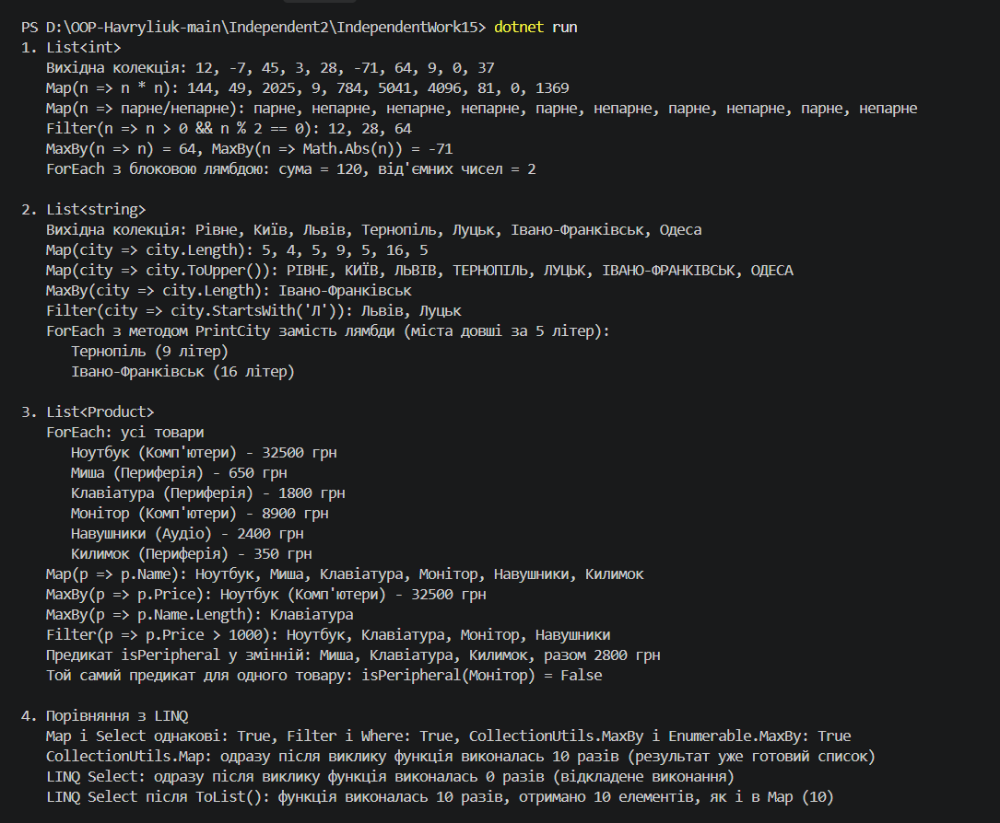

# Звіт до Самостійної роботи №15
**Тема:** Делегати й лямбда-вирази: власні утиліти для колекцій

## 1. Що реалізовано
Статичний клас `CollectionUtils` з чотирма узагальненими методами:
* `Map<TSource, TResult>(collection, Func<TSource, TResult> mapper)` — перетворює кожен елемент і повертає новий список.
* `MaxBy<T, TKey>(collection, Func<T, TKey> keySelector) where TKey : IComparable<TKey>` — бере перший елемент як поточний максимум і порівнює з ним ключі решти елементів через `CompareTo`. Для порожньої колекції викидає `InvalidOperationException`, щоб не повертати непомітне значення за замовчуванням.
* `Filter<T>(collection, Predicate<T> predicate)` — повертає елементи, для яких предикат дав `true`.
* `ForEach<T>(collection, Action<T> action)` — виконує дію для кожного елемента.

Кожен метод перевіряє аргументи на `null` через `ArgumentNullException.ThrowIfNull`.

Демонстрація працює з трьома колекціями: `List<int>`, `List<string>` і `List<Product>`. Використано різні види лямбда-виразів:
* прості вирази (`n => n * n`);
* блокову лямбду з кількома командами (сума й підрахунок від'ємних чисел у `ForEach`);
* замикання на зовнішніх змінних (`limit`, `letter`, `peripheralTotal`);
* предикат, збережений у змінній `Predicate<Product> isPeripheral` і використаний двічі;
* передачу іменованого методу `PrintCity` замість лямбди.

## 2. Результат виконання

## 3. Звіт

### Чому делегати корисні для створення таких утиліт?
Делегат дає змогу передати в метод не дані, а поведінку. `Filter` сам по собі не знає, що саме треба відфільтрувати: парні числа, міста на «Л» чи дорогі товари. Цю умову передає той, хто викликає метод. Тому один метод з одним циклом `foreach` працює для будь-якої колекції та будь-якої умови, і цикл не треба переписувати щоразу. Делегат можна зберегти в змінну (`isPeripheral`), передати кільком методам або викликати окремо.

### Як лямбда-вирази спрощують виклик цих методів?
Без лямбд для кожної умови довелося б писати окремий іменований метод, як `PrintCity`. Лямбда записує умову прямо в місці виклику: `CollectionUtils.Filter(products, p => p.Price > limit)` читається майже як речення. Компілятор сам виводить типи параметрів, тому не потрібно писати `(Product p) => ...`. Лямбда також може використовувати локальні змінні методу (замикання), наприклад поріг `limit` або лічильник `peripheralTotal`.

### Порівняння з вбудованими LINQ-операторами

| Мій метод | Аналог | Що спільного | Чим відрізняється |
| :--- | :--- | :--- | :--- |
| `Map` | `Select` | перетворює кожен елемент функцією | `Map` одразу будує `List`, а `Select` виконується відкладено, тільки коли результат перебирають |
| `Filter` | `Where` | залишає елементи за умовою | `Filter` приймає `Predicate<T>`, `Where` — `Func<T, bool>`; `Where` теж відкладений |
| `MaxBy` | `Enumerable.MaxBy` (.NET 6+) | шукає елемент з найбільшим ключем | для порожньої колекції мій метод завжди кидає виняток, а LINQ для посилальних типів повертає `null` |
| `ForEach` | `List<T>.ForEach` | виконує дію для кожного елемента | у LINQ немає `ForEach`, а `List<T>.ForEach` працює лише зі списком; мій метод приймає будь-який `IEnumerable<T>` |

У розділі 4 демонстрації програма перевіряє, що `Map`, `Filter` і `MaxBy` дають ті самі результати, що й `Select`, `Where` і `Enumerable.MaxBy`. Там же видно різницю у виконанні: після виклику `Map` функція вже виконалась 10 разів, а після виклику `Select` — 0 разів. Вона спрацьовує тільки під час `ToList()`. LINQ вигідніший, коли ланцюжок операцій довгий або потрібні лише перші елементи, бо не створює проміжних списків. Мої методи простіші для розуміння: результат готовий одразу, і його можна перебирати кілька разів без повторних обчислень.

## 4. Відповіді на контрольні запитання

1. **Чому делегати є зручним механізмом для передавання поведінки в узагальнені методи?**
   Узагальнений метод не знає конкретного типу елементів, тому не може сам вирішити, як їх перетворити чи порівняти. Делегат передає цю логіку ззовні, і той самий `Map` працює і з числами, і з товарами.

2. **У чому різниця між Func<T, TResult>, Action<T> та Predicate<T>?**
   `Func<T, TResult>` приймає значення і повертає результат (використано в `Map` і `MaxBy`). `Action<T>` приймає значення і нічого не повертає (`ForEach`). `Predicate<T>` приймає значення і повертає `bool`, тобто відповідає на питання «так чи ні» (`Filter`). За змістом `Predicate<T>` те саме, що `Func<T, bool>`, але це окремий тип делегата.

3. **Які переваги дає поєднання generic-методів і лямбда-виразів під час роботи з колекціями?**
   Generic-метод пишеться один раз для всіх типів і перевіряється компілятором. Лямбда коротко задає конкретну дію. Разом вони прибирають повторення однакових циклів і роблять код коротшим і зрозумілішим.

4. **У яких випадках власні утиліти на кшталт Map чи Filter корисно реалізувати самостійно, навіть якщо існує LINQ?**
   Для навчання, щоб зрозуміти, як працюють делегати і LINQ всередині. Також тоді, коли потрібна інша поведінка: негайне обчислення замість відкладеного, свій виняток для порожньої колекції, логування кожного кроку чи підтримка власних типів колекцій.
