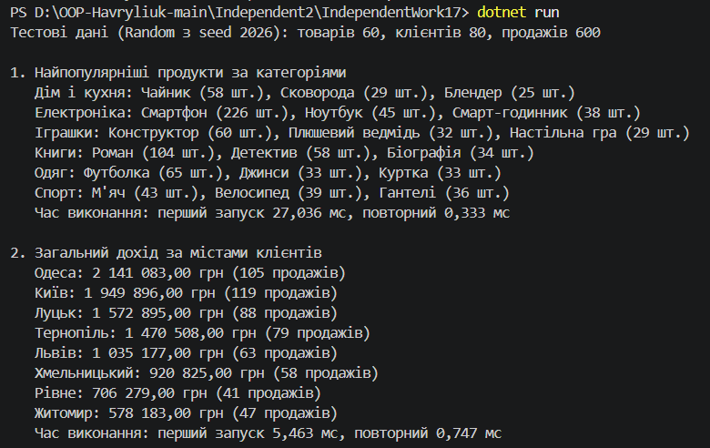
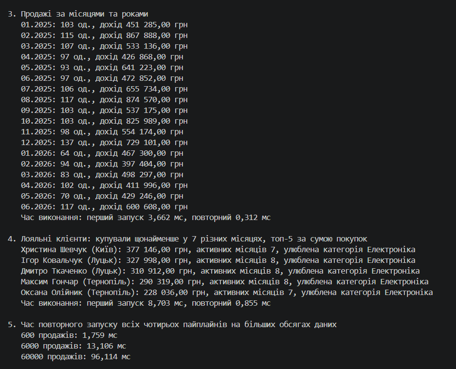

# Звіт до Самостійної роботи №17
**Тема:** LINQ pipelines: ETL та аналітика

## 1. Модель даних і тестові дані
* Сутності: `Sale` (Id, ProductId, Quantity, SaleDate, CustomerId), `Product` (Id, Name, Category, UnitPrice) і `Customer` (Id, Name, City). Результати пайплайнів описані окремими записами (`CategoryTop`, `CityRevenue`, `MonthlySales`, `LoyalCustomer`), щоб не повертати з методів анонімні типи.
* `SalesDataGenerator` генерує 60 товарів у 6 категоріях, 80 клієнтів з 8 міст і 600 продажів за січень 2025 — червень 2026. `Random` створюється з фіксованим seed 2026, тому при кожному запуску дані однакові й результати можна відтворити.
* Товари з меншим номером продаються частіше (індекс товару = випадкове число в квадраті × 60). Так у категоріях з'являються лідери, як у реальних продажах, а не однакові кількості.

## 2. Опис пайплайнів
Кожен пайплайн — окремий метод класу `SalesPipelines`, тому `Main` лише викликає їх і виводить результат.

1. **TopProductsByCategory — найпопулярніші продукти за категоріями**
   * **Мета:** знайти топ-3 товари за кількістю проданих одиниць у кожній категорії.
   * **Оператори:**
     * `GroupBy(ProductId)` + `Sum` рахують загальну кількість для кожного товару;
     * `Join` з `products` додає назву й категорію;
     * другий `GroupBy(Category)` збирає товари за категоріями;
     * усередині кожної групи `OrderByDescending(Quantity)`, `ThenBy(Name)` і `Take(3)` вибирають лідерів.
   * **Чому так:** спочатку агрегуємо продажі, а потім приєднуємо товари, тому `Join` працює з 60 підсумками, а не з усіма 600 продажами. `ThenBy` робить результат однозначним, коли кількості однакові.

2. **RevenueByCity — загальний дохід за містами клієнтів**
   * **Мета:** порахувати виручку в розрізі міст покупців.
   * **Оператори:**
     * перший `Join` з `products` дає ціну і дохід продажу (`Quantity * UnitPrice`);
     * другий `Join` з `customers` дає місто;
     * `GroupBy(City)` + `Sum` + `Count` рахують підсумки;
     * `OrderByDescending(Revenue)` сортує результат.
   * **Чому так:** дохід залежить від двох довідників, тому без двох `Join` не обійтися. Кількість продажів виводиться поруч, щоб було видно, чи місто лідирує завдяки кількості покупок, чи завдяки дорогим товарам.

3. **SalesByMonth — продажі за місяцями та роками**
   * **Мета:** побачити динаміку продажів у часі.
   * **Оператори:**
     * `Join` з `products` дає дохід;
     * `GroupBy` за складеним анонімним ключем `new { Year, Month }`;
     * два `Sum` рахують одиниці й дохід;
     * `OrderBy(Year)` + `ThenBy(Month)` сортують за часом.
   * **Чому так:** анонімний тип порівнюється за значеннями полів, тому всі продажі одного місяця одного року потрапляють в одну групу. Групувати лише за `Month` не можна, бо тоді січень 2025 і січень 2026 злилися б.

4. **LoyalCustomers — лояльні клієнти (додатковий пайплайн)**
   * **Мета:** знайти клієнтів, які купували щонайменше у 7 різних місяцях, і показати п'ятьох, що витратили найбільше, з їх улюбленою категорією.
   * **Оператори:**
     * `Join` з `products`;
     * `GroupBy(CustomerId)`;
     * у `Select`: `Distinct` + `Count` рахують різні місяці, `Sum` — суму витрат, а вкладений `GroupBy(Category)` + `OrderByDescending` + `First` знаходить улюблену категорію;
     * `Where` залишає тих, хто має 7+ активних місяців;
     * `Join` з `customers` додає ім'я і місто;
     * `OrderByDescending` + `Take(5)` вибирають топ-5.
   * **Чому так:** фільтр `Where` стоїть перед другим `Join`, щоб не приєднувати дані клієнтів, які все одно буде відкинуто.

## 3. Вимірювання продуктивності
Для кожного пайплайну програма створює новий `Stopwatch` і запускає пайплайн двічі: перший запуск і повторний. Кожен метод закінчується `ToList()`, тому весь запит справді виконується всередині вимірювання. Без `ToList()` LINQ лише побудував би ланцюжок, і час був би майже нульовим.

| Пайплайн | Перший запуск, мс | Повторний запуск, мс |
| :--- | :--- | :--- |
| 1. Топ-3 за категоріями | … | … |
| 2. Дохід за містами | … | … |
| 3. Продажі за місяцями | … | … |
| 4. Лояльні клієнти | … | … |

| Продажів | Усі 4 пайплайни (повторний запуск), мс |
| :--- | :--- |
| 600 | … |
| 6000 | … |
| 60000 | … |

Значення переносяться з виводу програми. Час залежить від комп'ютера.

### Які фактори впливають на час виконання
* **JIT-компіляція.** Під час першого запуску .NET компілює методи LINQ і лямбди в машинний код, тому перший запуск завжди повільніший за повторний. Справедливіше порівнювати повторні запуски.
* **Обсяг даних.** `Join` і `GroupBy` будують усередині хеш-таблиці, тому їх час росте приблизно лінійно з кількістю продажів. Тому при збільшенні даних у 10 разів час має зрости приблизно в 10 разів, а не в 100, як було б із вкладеними циклами. Це перевіряється другою таблицею.
* **Кількість проміжних об'єктів.** Кожен `Select` і `Join` створює анонімні об'єкти, тож при великих обсягах додається робота збирача сміття.
* **Порядок операторів.** Ранній `Where` і агрегація перед `Join` зменшують обсяг даних для наступних кроків.
* **Режим збірки та середовище.** `dotnet run` за замовчуванням збирає Debug-версію без оптимізацій, а на результат також впливають інші програми, запущені на комп'ютері. Тому окремий вимір у частки мілісекунди може відрізнятися від запуску до запуску.

## 4. Висновки
* LINQ добре підходить для ETL і аналітики: кожен пайплайн записано як послідовність кроків «з'єднати → згрупувати → порахувати → відсортувати», яка читається майже як опис задачі. Ручні цикли з власними словниками для того самого зайняли б у кілька разів більше коду.
* Для сотень і тисяч записів пайплайни виконуються за частки мілісекунди або кілька мілісекунд, тому продуктивність LINQ тут не є проблемою.
* Треба пам'ятати про відкладене виконання: запит виконується в момент `ToList()` чи перебору, а не там, де його оголошено. Також порядок операторів (спочатку фільтр і агрегація, потім `Join`) помітно впливає на обсяг роботи.

## 5. Результат виконання

## 6. Відповіді на контрольні запитання

1. **Які переваги дає LINQ для побудови ETL-пайплайнів порівняно з ручними циклами?**
   LINQ описує, що потрібно отримати, а не як перебирати дані. `Join` і `GroupBy` вже реалізовані ефективно через хеш-таблиці, тому не треба самому писати словники для групування. Код коротший, у ньому менше місць для помилки, і окремі кроки легко міняти місцями чи додавати нові.

2. **Чому для аналітичних задач часто поєднують Join, GroupBy, Select та OrderBy в одному пайплайні?**
   Це повний цикл обробки: `Join` збирає дані з кількох джерел (Extract), `Select` і `GroupBy` з агрегатами перетворюють і підсумовують їх (Transform), а `OrderBy` готує результат до показу (Load). Майже кожен аналітичний звіт складається з цих кроків.

3. **Які фактори можуть найбільше впливати на продуктивність складних LINQ-запитів?**
   Обсяг даних, порядок операторів (фільтр до чи після `Join`), кількість проміжних об'єктів, повторне виконання одного відкладеного запиту кілька разів, а також JIT-компіляція під час першого запуску.

4. **Як перевірити, що LINQ-пайплайн не лише працює, а й залишається читабельним і підтримуваним?**
   Пайплайн має бути окремим методом з назвою, що пояснює його мету. Кожен оператор записують з нового рядка, а замість безіменних кортежів використовують записи з іменованими полями. Результат варто перевірити на невеликих даних, де відповідь легко порахувати вручну. Якщо ланцюжок стає задовгим, його розбивають на кілька методів.
