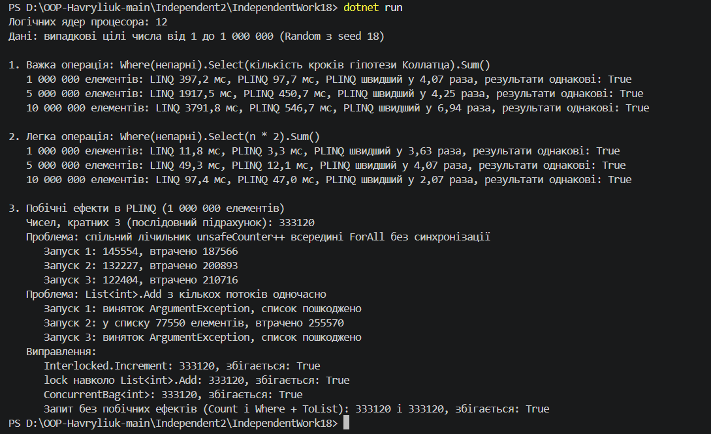

# Звіт до Самостійної роботи №18
**Тема:** PLINQ: дослідження продуктивності та безпеки

## 1. Опис експериментів
* **Дані:** `List<int>` на 1 000 000, 5 000 000 і 10 000 000 випадкових чисел від 1 до 1 000 000. `Random` з фіксованим seed, тому дані при кожному запуску однакові.
* **Важка операція:** для кожного непарного числа рахується кількість кроків гіпотези Коллатца: поки число не стане 1, парне ділимо на 2, а непарне множимо на 3 і додаємо 1. Для чисел до мільйона це в середньому понад сотню ітерацій циклу на елемент, тобто процесор справді завантажений. Запит: `Where(n => n % 2 == 1).Select(n => (long)CollatzSteps(n)).Sum()`.
* **Легка операція:** той самий запит, але замість гіпотези Коллатца просто `n * 2`. Вона потрібна для порівняння: тут робота над елементом дуже дешева.
* **Як порівнюється:** запит виконується звичайним LINQ і через `AsParallel()`, час кожного вимірюється окремим `Stopwatch`. Результат — ціле число (`long`), тому програма перевіряє, що LINQ і PLINQ дали однакову відповідь. Перед вимірюванням виконується прогрівання на 10 000 елементів, щоб у час не потрапила JIT-компіляція.

## 2. Результати

| Елементів | Операція | LINQ, мс | PLINQ, мс | Прискорення |
| :--- | :--- | :--- | :--- | :--- |
| 1 000 000 | важка | … | … | … |
| 5 000 000 | важка | … | … | … |
| 10 000 000 | важка | … | … | … |
| 1 000 000 | легка | … | … | … |
| 5 000 000 | легка | … | … | … |
| 10 000 000 | легка | … | … | … |

Значення переносяться з виводу програми. Програма також показує кількість логічних ядер процесора, бо від неї залежить можливе прискорення.

## 3. Аналіз: коли PLINQ швидший, а коли ні
* **Важка операція.** PLINQ ділить колекцію на частини й обробляє їх на кількох ядрах одночасно. Коли кожен елемент потребує багато обчислень, витрати на розподіл роботи й об'єднання результатів малі порівняно з самими обчисленнями. Тому тут PLINQ має бути помітно швидшим, хоча прискорення менше за кількість ядер: частина часу йде на координацію потоків, а ядра з Hyper-Threading не дають повноцінного подвоєння.
* **Легка операція.** Множення на 2 виконується за наносекунди, тому основний час іде на перебір пам'яті та накладні витрати PLINQ: створення задач, розбиття колекції, підсумовування часткових сум. Виграш тут значно менший, а на меншій колекції PLINQ може виявитися навіть повільнішим.
* **Розмір колекції.** Чим більше елементів, тим краще накладні витрати розподіляються між корисною роботою. Тому для правильного висновку потрібно кілька розмірів: один вимір може випадково показати виграш чи програш.
* **Інші фактори:** кількість ядер, інші запущені програми, Debug-збірка через `dotnet run`, а також те, що `List<int>` спочатку треба розбити на частини для потоків.

## 4. Побічні ефекти та потокобезпечність
* **Як виникла проблема.** У `ForAll` кілька потоків одночасно виконують `unsafeCounter++` для спільної змінної. Інкремент складається з трьох кроків: прочитати значення, додати 1, записати. Якщо два потоки прочитали те саме значення, один запис губиться. Тому лічильник показує менше, ніж справжня кількість, і при кожному запуску результат інший (програма запускає сценарій тричі). Те саме з `List<int>.Add`: список не потокобезпечний, тож елементи губляться або виникає виняток, коли два потоки одночасно розширюють внутрішній масив.
* **Як виправлено:**
  * `Interlocked.Increment` — атомарний інкремент на рівні процесора. Це найшвидший спосіб для простого лічильника.
  * `lock` навколо `List<int>.Add` — тільки один потік за раз може змінювати список. Спосіб універсальний, але потоки чекають один одного, тож при частих записах паралельність втрачається.
  * `ConcurrentBag<int>` — колекція, спеціально створена для одночасного додавання з багатьох потоків.
  * Запит без побічних ефектів (`AsParallel().Count(...)` і `Where(...).ToList()`) — найкраще рішення: PLINQ сам рахує частини в кожному потоці й правильно їх об'єднує, і спільний змінюваний стан не потрібен.

## 5. Висновки
* PLINQ доцільний для великих колекцій з обчислювально важкою, незалежною обробкою кожного елемента: такі задачі добре діляться між ядрами.
* Для легких операцій і малих колекцій PLINQ дає малий виграш або програє, тому вмикати його «про всяк випадок» не варто. Рішення треба приймати за результатами вимірювань.
* Лямбди в PLINQ не повинні змінювати спільний стан. Якщо без цього не обійтися, потрібні `Interlocked`, `lock` або потокобезпечні колекції. Але краще переписати задачу як чистий запит, що повертає результат.

## 6. Результат виконання

## 7. Відповіді на контрольні запитання

1. **За яких умов PLINQ зазвичай дає виграш у продуктивності порівняно зі звичайним LINQ?**
   Коли колекція велика, обробка кожного елемента вимагає багато обчислень, елементи не залежать один від одного, а в комп'ютері кілька ядер.

2. **Чому побічні ефекти всередині PLINQ-запитів можуть призводити до некоректних результатів?**
   Лямбда виконується одночасно в кількох потоках. Якщо вона змінює спільну змінну чи колекцію без синхронізації, операції потоків накладаються, і частина змін губиться. Це гонитва даних (race condition), і результат щоразу інший.

3. **Для чого в експериментах важливо порівнювати кілька розмірів колекції, а не один випадок?**
   Щоб побачити, як змінюється виграш зі зростанням даних, і знайти межу, з якої паралельність починає окуплятися. Один вимір може бути випадковим і не показує тенденції.

4. **Які висновки слід зробити, якщо PLINQ виявився повільнішим за LINQ у частині тестів?**
   Для цих даних операція надто легка або колекція надто мала, і накладні витрати на потоки більші за виграш. У такому разі краще залишити звичайний LINQ, а PLINQ застосовувати тільки там, де вимірювання показали реальний виграш.
