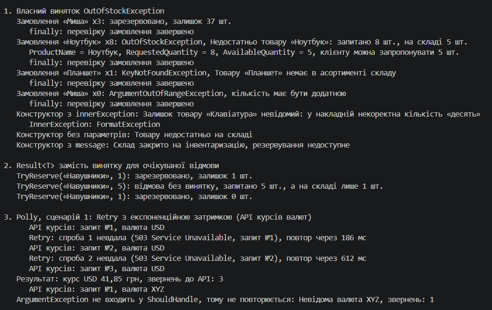
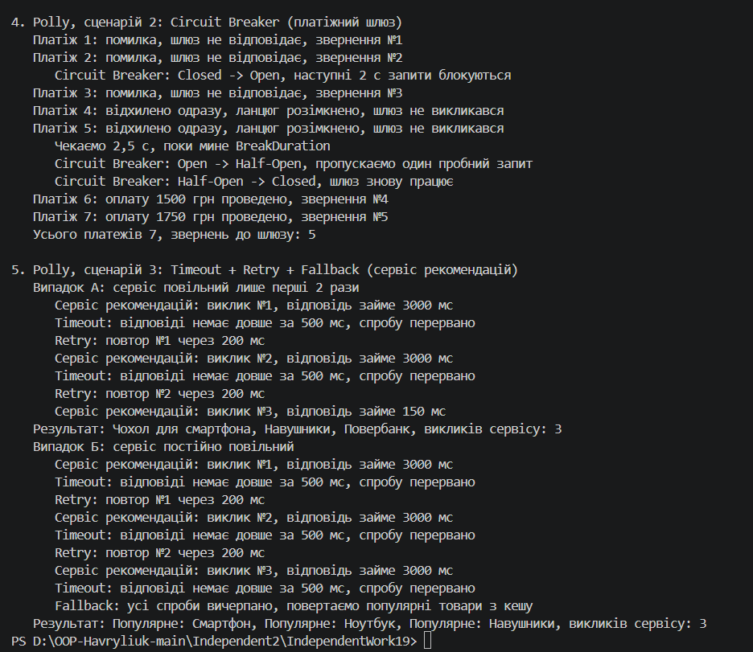

# Звіт до Самостійної роботи №19
**Тема:** Дизайн винятків і політики retry: теорія та кейси Polly

Проєкт використовує пакет `Polly.Core` 8.9.1 (актуальний API `ResiliencePipelineBuilder`). Під час першого `dotnet run` пакет завантажується з NuGet автоматично.

## 1. Власний тип винятку OutOfStockException
**Предметна область:** склад інтернет-магазину. Виняток кидається, коли клієнт хоче зарезервувати більше товару, ніж є на складі.

```csharp
public class OutOfStockException : Exception
{
    public string ProductName { get; } = string.Empty;
    public int RequestedQuantity { get; }
    public int AvailableQuantity { get; }

    public OutOfStockException() : base("Товару недостатньо на складі") { }
    public OutOfStockException(string message) : base(message) { }
    public OutOfStockException(string message, Exception innerException) : base(message, innerException) { }
    public OutOfStockException(string productName, int requestedQuantity, int availableQuantity) : base(...) { ... }
}
```

* Три стандартні конструктори: без параметрів (з українським повідомленням за замовчуванням), з `message`, з `message` та `innerException`. Четвертий конструктор заповнює додаткові властивості й сам формує повідомлення.
* Додаткові властивості `ProductName`, `RequestedQuantity` і `AvailableQuantity` дають обробнику дані, з якими можна працювати далі. Наприклад, програма пропонує клієнту стільки товару, скільки лишилося, а не просто виводить текст помилки.
* У `Main` метод `PlaceOrder` викликає `Warehouse.Reserve` у блоці `try` з кількома `catch`: спочатку `OutOfStockException`, потім `KeyNotFoundException` (товару немає в асортименті), `ArgumentOutOfRangeException` (кількість ≤ 0) і наприкінці загальний `Exception`. Блок `finally` виконується для кожного замовлення.
* `LoadStockFromInvoice` перехоплює `FormatException` від `int.Parse` і загортає його в `OutOfStockException` через конструктор з `innerException`, тому початкова причина помилки не губиться.

## 2. Коли кидати виняток, а коли повертати Result<T>
Виняток варто кидати, коли метод не може виконати свій контракт і ситуація справді виняткова: зник файл, обірвалося з'єднання з базою, у накладній пошкоджені дані. Виняток неможливо випадково проігнорувати, і він несе стек викликів, але його обробка повільніша за звичайне повернення значення. Result<T> краще повертати, коли невдача — нормальний, очікуваний результат: користувач ввів некоректні дані, шуканого елемента немає, бізнес-правило не дозволяє операцію. У проєкті це показано двома методами складу. `Reserve` кидає `OutOfStockException`, бо його викликає код, який уже перевірив замовлення і не чекає відмови. `TryReserve` повертає `Result<int>`, бо його використовує форма замовлення, де брак товару — звичайна ситуація, про яку треба просто повідомити клієнта. З Result<T> можлива відмова видно прямо в сигнатурі методу, але викликач мусить сам не забути перевірити `IsSuccess`.

## 3. Сценарії Polly

### Сценарій 1. Retry з експоненційною затримкою: API курсів валют
* **Проблема:** зовнішній API курсів валют іноді на кілька секунд відповідає `503 Service Unavailable` через перевантаження. Такий збій тимчасовий, тож повторний запит через мить зазвичай вдається.
* **Стратегія:** Retry, бо помилка тимчасова, а запит курсу безпечно повторювати (він нічого не змінює). Затримка експоненційна (300 мс, далі більша), щоб не засипати перевантажений сервер запитами. Jitter додає випадкову складову, щоб багато клієнтів не повторювали запити одночасно. `ShouldHandle` обробляє лише `HttpRequestException`: помилку «невідома валюта» повтори не виправлять.
* **Фрагмент коду:**

```csharp
new ResiliencePipelineBuilder()
    .AddRetry(new RetryStrategyOptions
    {
        ShouldHandle = new PredicateBuilder().Handle<HttpRequestException>(),
        MaxRetryAttempts = 3,
        Delay = TimeSpan.FromMilliseconds(300),
        BackoffType = DelayBackoffType.Exponential,
        UseJitter = true,
        OnRetry = args => { Console.WriteLine(...); return default; }
    })
    .Build();
```

* **Вивід:** API двічі відповідає 503. Після кожної невдачі `OnRetry` пише номер спроби, причину і випадкову затримку. Третій запит повертає курс, отже звернень до API 3. Окремий виклик з валютою «XYZ» кидає `ArgumentException` одразу, без повторів, і звернення лише одне.

### Сценарій 2. Circuit Breaker: платіжний шлюз
* **Проблема:** платіжний шлюз «упав» на тривалий час. Якщо кожен платіж повторювати, клієнти довго чекатимуть, а шлюз, що відновлюється, отримає ще більше запитів.
* **Стратегія:** Circuit Breaker. Коли щонайменше половина з мінімум трьох запитів за 10 с завершилася помилкою, ланцюг розмикається (Open), і протягом 2 с запити відхиляються миттєво з `BrokenCircuitException`, без звернення до шлюзу. Потім ланцюг переходить у Half-Open і пропускає один пробний запит: якщо він успішний, стан повертається в Closed. Це відмінний від Retry патерн: він не повторює, а навпаки зупиняє запити до несправного сервісу.
* **Фрагмент коду:**

```csharp
new ResiliencePipelineBuilder()
    .AddCircuitBreaker(new CircuitBreakerStrategyOptions
    {
        ShouldHandle = new PredicateBuilder().Handle<HttpRequestException>(),
        FailureRatio = 0.5,
        MinimumThroughput = 3,
        SamplingDuration = TimeSpan.FromSeconds(10),
        BreakDuration = TimeSpan.FromSeconds(2),
        OnOpened = _ => { ... }, OnHalfOpened = _ => { ... }, OnClosed = _ => { ... }
    })
    .Build();
```

* **Вивід:** платежі 1–3 отримують помилку шлюзу, і після третьої з'являється перехід Closed → Open. Платежі 4 і 5 відхиляються одразу. Після паузи 2,5 с видно перехід Open → Half-Open, платіж 6 проходить, і стан стає Closed. Платіж 7 теж успішний. Підсумок показує 7 платежів і лише 5 звернень до шлюзу, бо 2 платежі шлюз не навантажили.

### Сценарій 3. Timeout + Retry + Fallback: сервіс рекомендацій
* **Проблема:** сервіс рекомендацій для сторінки товару іноді «зависає» на кілька секунд. Чекати на нього довго не можна, бо сторінка відкриватиметься повільно. Без рекомендацій сторінка працює, тож у крайньому разі можна показати щось просте.
* **Стратегія:** комбінація трьох стратегій.
  * Timeout обмежує кожну спробу до 500 мс.
  * Retry двічі повторює спробу, що перевищила час.
  * Fallback, якщо всі три спроби невдалі, повертає список популярних товарів із кешу замість помилки.

  Порядок у builder важливий: стратегія, додана першою, стає зовнішньою. Тому Fallback стоїть першим і охоплює всі повтори, а Timeout останнім і обмежує кожну окрему спробу. Timeout у Polly кооперативний, тож сервіс приймає `CancellationToken` і перестає чекати, щойно токен скасовано.
* **Фрагмент коду:**

```csharp
new ResiliencePipelineBuilder<List<string>>()
    .AddFallback(new FallbackStrategyOptions<List<string>>
    {
        ShouldHandle = new PredicateBuilder<List<string>>().Handle<TimeoutRejectedException>(),
        FallbackAction = _ => Outcome.FromResultAsValueTask(cachedRecommendations)
    })
    .AddRetry(new RetryStrategyOptions<List<string>> { MaxRetryAttempts = 2, ... })
    .AddTimeout(new TimeoutStrategyOptions { Timeout = TimeSpan.FromMilliseconds(500) })
    .Build();
```

* **Вивід:**
  * **Випадок А:** перші два виклики мали б тривати 3 с, але Timeout перериває їх через 500 мс, а Retry повторює. Третій виклик відповідає за 150 мс, і повертаються справжні рекомендації.
  * **Випадок Б:** сервіс постійно повільний, тому всі три спроби перериваються. Спрацьовує Fallback, і користувач отримує популярні товари з кешу, а не помилку.

## 4. Загальні висновки
**Переваги Polly:**
* Логіка відмовостійкості описана декларативно в одному місці і відокремлена від бізнес-коду: `ExchangeRateApi` чи `PaymentGateway` нічого не знають про повтори.
* Стратегії легко комбінувати й налаштовувати.
* Колбеки `OnRetry`, `OnOpened`, `OnTimeout` і `OnFallback` дають зручні точки для логування.
* Бібліотека вже правильно реалізує складні речі на зразок jitter і станів Circuit Breaker, тож їх не треба писати вручну.

**Обмеження:**
* Polly не робить операцію безпечною для повторення. Неідемпотентні операції, наприклад списання грошей, повторювати не можна без додаткового захисту.
* Timeout працює лише тоді, коли код поважає `CancellationToken`.
* Неправильні параметри шкодять: надто багато повторів затримує відповідь, а надто чутливий Circuit Breaker блокує робочий сервіс.
* Комбінації стратегій ускладнюють розуміння порядку виконання, тому їх треба тестувати.

## 5. Результат виконання



## 6. Відповіді на контрольні запитання

1. **Поясніть різницю між підходами «кидати виняток» та «повертати Result». Наведіть приклад для кожного.**
   Виняток перериває звичайне виконання і передає керування найближчому відповідному `catch`. Він підходить для виняткових ситуацій: `Reserve` кидає `OutOfStockException`, коли код, що вже перевірив замовлення, раптом не може його виконати. Result повертається як звичайне значення, і викликач сам перевіряє успіх. Він підходить для очікуваних відмов: `TryReserve` повертає `Result<int>` з текстом помилки, коли товару не вистачає.

2. **Які три стандартні конструктори рекомендується реалізовувати у власному типі винятку?**
   Конструктор без параметрів, конструктор з `string message` і конструктор з `string message, Exception innerException`. Останній дає змогу загорнути початковий виняток, не втративши його.

3. **Чим Circuit Breaker відрізняється від Retry? Коли який патерн доцільніший?**
   Retry повторює операцію в надії, що збій короткочасний. Circuit Breaker після серії помилок взагалі припиняє звернення до сервісу на певний час і миттєво повертає помилку. Retry доцільний для коротких збоїв (поодинокі 503, обрив з'єднання), а Circuit Breaker — коли сервіс недоступний довго і повтори лише навантажують його та змушують користувачів чекати. Їх часто поєднують.

4. **Для чого потрібен Bulkhead і яку проблему він вирішує?**
   Bulkhead обмежує кількість одночасних операцій для певного ресурсу, наприклад не більше 10 паралельних запитів до зовнішнього API. Так повільний чи несправний сервіс не забирає всі потоки й з'єднання застосунку, і решта функцій продовжує працювати, як відсіки корабля, що не дають затопити весь корпус.

5. **Чому Jitter важливий при реалізації Retry з експоненційною затримкою?**
   Якщо сервер упав для багатьох клієнтів одночасно, без jitter усі вони повторюватимуть запити в однакові моменти (через 1 с, 2 с, 4 с) і знову перевантажать сервер хвилею запитів. Випадкова складова розносить повтори в часі.

6. **Які ризики виникають при застосуванні Retry до неідемпотентної операції?**
   Неідемпотентна операція при повторі змінює стан ще раз. Якщо платіж насправді пройшов, але відповідь загубилася через таймаут, повтор спише гроші двічі, а повторна відправка замовлення створить дублікат. Для таких операцій потрібні ключі ідемпотентності або перевірка стану перед повтором, інакше Retry вмикати не можна.
