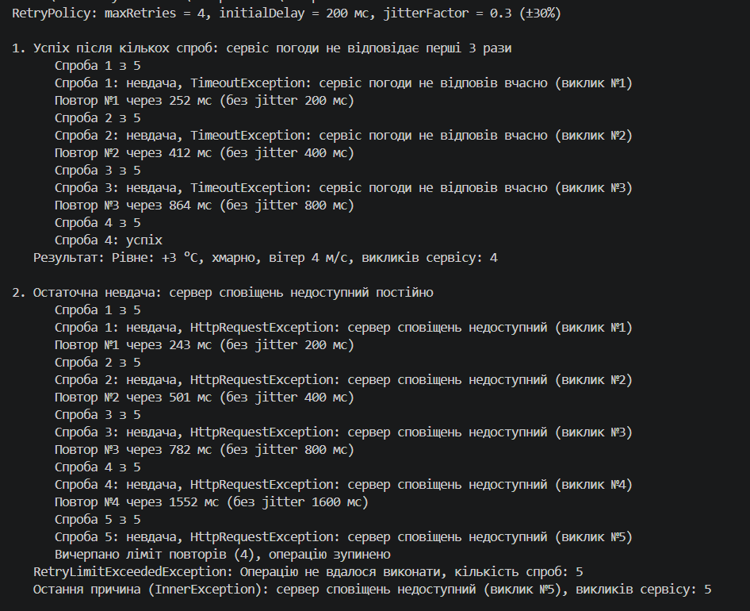
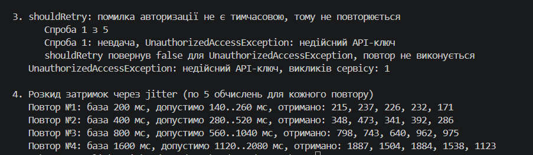

# Звіт до Самостійної роботи №20
**Тема:** Реалізація exponential backoff

## 1. Що реалізовано
**Клас RetryPolicy:**
* Приватні поля `_maxRetries`, `_initialDelay` і `_jitterFactor`. Конструктор `RetryPolicy(int maxRetries, TimeSpan initialDelay, double jitterFactor = 0.2)` перевіряє, що кількість повторів і затримка не від'ємні, а jitter лежить у межах від 0 до 1.
* Узагальнений метод `Execute<T>(Func<T> operation, Func<Exception, bool> shouldRetry = null)` працює для будь-якої операції, що повертає значення. Він виконує операцію і логує кожну спробу, причину невдачі та обчислену затримку.
* Якщо `shouldRetry` повертає `false`, виняток одразу передається далі без повторів.
* Якщо ліміт повторів вичерпано, кидається власний `RetryLimitExceededException` з кількістю спроб, а останній виняток зберігається як `InnerException`.

**Формула затримки:** реалізована в методі `CalculateDelay` точно за завданням:

`delay = initialDelay * Math.Pow(2, retryAttempt) * (1 + random.NextDouble() * jitterFactor * 2 - jitterFactor)`

Множник у дужках випадково лежить у межах від `1 − jitterFactor` до `1 + jitterFactor`. Для моїх параметрів (200 мс, jitter 0.3) затримки такі:

| Повтор | Без jitter | З jitter ±30% |
| :--- | :--- | :--- |
| №1 | 200 мс | 140–260 мс |
| №2 | 400 мс | 280–520 мс |
| №3 | 800 мс | 560–1040 мс |
| №4 | 1600 мс | 1120–2080 мс |

**Демонстрація в Main** (одна політика: maxRetries = 4, initialDelay = 200 мс, jitterFactor = 0.3):
1. Сервіс погоди тричі кидає `TimeoutException`, а на четвертій спробі повертає прогноз.
2. Сервер сповіщень недоступний постійно: після 5 спроб (1 + 4 повтори) політика кидає `RetryLimitExceededException`.
3. Помилка авторизації `UnauthorizedAccessException` не проходить перевірку `shouldRetry` (повторюються лише `TimeoutException` і `HttpRequestException`), тому повторів немає.
4. Для кожного повтору затримка обчислюється 5 разів. Значення різні, але всі лежать у межах ±30% від бази, що показує роботу jitter.

## 2. Результат виконання

## 3. Висновок щодо меж застосування Retry з exponential backoff
Retry з експоненційною затримкою доречний лише для тимчасових збоїв: таймаутів, перевантаження сервера (503), короткої втрати мережі. Тоді кожна наступна пауза дає сервісу більше часу на відновлення, а jitter не дає багатьом клієнтам повторювати запити одночасно. Для постійних помилок (недійсний ключ, некоректні дані, відсутній ресурс) повтори безглузді: вони лише затримують відповідь, тому їх треба відсікати через `shouldRetry`. Небезпечно повторювати неідемпотентні операції на зразок оплати чи створення замовлення, бо повтор може виконати дію двічі. Також кількість повторів має бути обмеженою: затримка росте експоненційно, і вже на четвертому повторі в моєму прикладі вона сягає 2 с, а користувач не може чекати безкінечно. Якщо сервіс недоступний довго, краще поєднати Retry з Circuit Breaker, який на час збою зовсім припинить звернення.

## 4. Відповіді на контрольні запитання

1. **Чому експоненційна затримка зазвичай ефективніша за фіксовану для тимчасових збоїв?**
   Якщо сервіс відновився швидко, перший повтор через коротку паузу одразу вдасться. Якщо збій триваліший, паузи швидко зростають, і клієнт не засипає перевантажений сервер частими запитами. Фіксована затримка або надто довга для коротких збоїв, або надто часта для довгих.

2. **Для чого потрібен jitter і як він зменшує ризик одночасних повторних спроб?**
   Коли сервер падає, помилку одночасно отримують багато клієнтів. Без jitter усі вони повторять запит рівно через 200, 400, 800 мс і знову створять пікове навантаження. Jitter додає кожному клієнту випадкове відхилення (у мене до ±30%), і повтори розподіляються в часі.

3. **Яку роль відіграє делегат shouldRetry у власній реалізації політики повторних спроб?**
   Він дає викликачу вирішити, які помилки тимчасові й варті повтору, а які ні. Сама `RetryPolicy` не знає, що означає конкретний виняток, тому ця логіка передається ззовні: у демонстрації повторюються таймаути й мережеві помилки, а помилка авторизації відразу передається далі.

4. **У яких випадках повторна спроба не є безпечною та її слід заборонити?**
   Коли операція неідемпотентна, тобто повтор змінює стан ще раз: списання коштів, відправка листа, створення замовлення. Якщо перша спроба насправді виконалась, а загубилась лише відповідь, повтор призведе до дубля. Також повтор не має сенсу для помилок, які самі не зникнуть: некоректні дані, відсутність прав, неіснуючий ресурс.
