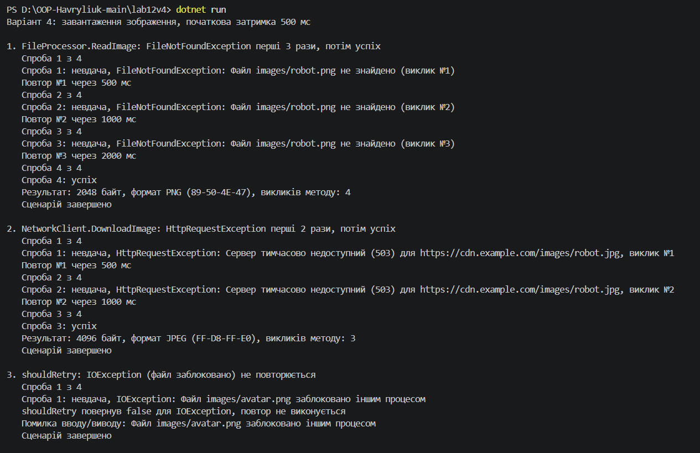
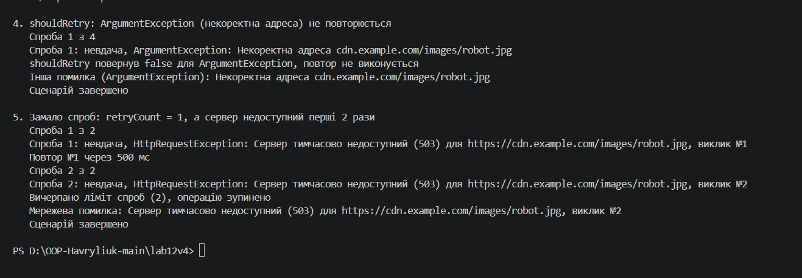

# Лабораторна робота №12: Обробка IO/мережевих помилок та патерн Retry.

**Тема:** Обробка IO/мережевих помилок та патерн Retry.

**Мета:** Навчитися обробляти типові помилки вводу/виводу та мережеві помилки за допомогою блоків try-catch-finally, а також реалізувати патерн Retry для підвищення відмовостійкості застосунків.

## Хід роботи

За допомогою .NET CLI створено консольний проєкт lab12v4 у директорії OOP-Havryliuk.

Створено клас FileProcessor з методом ReadImage, який імітує читання зображення з файлу: перші 3 виклики викидають FileNotFoundException, далі метод повертає байти зображення PNG, а для заблокованого файлу викидається IOException. Створено клас NetworkClient з методом DownloadImage, який імітує завантаження зображення з мережі: перші 2 виклики викидають HttpRequestException, далі метод повертає байти зображення JPEG, а для некоректної адреси викидається ArgumentException.

Створено статичний клас RetryHelper з узагальненим методом ExecuteWithRetry. Він виконує передану операцію, логує кожну спробу з часом і причиною невдачі, між спробами чекає initialDelay * 2^retryAttempt і через делегат shouldRetry вирішує, чи варто повторювати спробу для конкретного винятку.

У Main показано 5 сценаріїв з початковою затримкою 500 мс, де shouldRetry повторює лише FileNotFoundException та HttpRequestException: читання файлу вдається з 4-ї спроби, завантаження з мережі вдається з 3-ї спроби, заблокований файл і некоректна адреса не повторюються, а при retryCount = 1 ліміт спроб вичерпується раніше, ніж приходить успіх. Кожен сценарій виконується в блоці try-catch-finally: catch обробляє винятки від конкретного до загального, а finally завжди виводить повідомлення про завершення сценарію.

## Результат виконання

## Висновок

У моєму варіанті початкова затримка 500 мс і після кожної невдачі вона подвоюється, тому для FileProcessor (3 невдачі) паузи між спробами становлять 500, 1000 і 2000 мс, а успішною стає 4-та спроба. Для NetworkClient (2 невдачі) паузи становлять 500 і 1000 мс, а успіх настає на 3-й спробі. Така затримка дає файлу чи серверу дедалі більше часу на відновлення і не перевантажує його частими запитами, а shouldRetry не дає марно повторювати помилки, які самі не зникнуть.

## Відповіді на контрольні питання

* **Які типи винятків найчастіше виникають при роботі з файлами та мережею?**
  При роботі з файлами: FileNotFoundException, DirectoryNotFoundException, IOException, UnauthorizedAccessException. При роботі з мережею: HttpRequestException, SocketException, TaskCanceledException (перевищено час очікування).

* **Поясніть принцип роботи патерну Retry. Коли його доцільно використовувати?**
  Якщо операція завершилася помилкою, її виконують ще раз, але не більше заданої кількості разів. Патерн доцільний для тимчасових збоїв: сервер перевантажений, файл ще не з'явився, зникла мережа. Для постійних помилок (некоректна адреса, немає прав доступу) повтори не допоможуть.

* **Як реалізувати експоненційну затримку між повторними спробами?**
  Затримку перед кожним повтором рахують за формулою initialDelay * 2^n, де n — номер повтору, починаючи з 0. При початковій затримці 500 мс паузи становлять 500, 1000, 2000 мс, тобто кожна наступна вдвічі довша за попередню.

* **Для чого потрібен делегат shouldRetry у допоміжному класі RetryHelper?**
  Він визначає, для яких винятків варто повторювати спробу. У цій роботі повторюються лише FileNotFoundException та HttpRequestException, а IOException заблокованого файлу і ArgumentException некоректної адреси одразу передаються далі, бо повтор їх не виправить.
