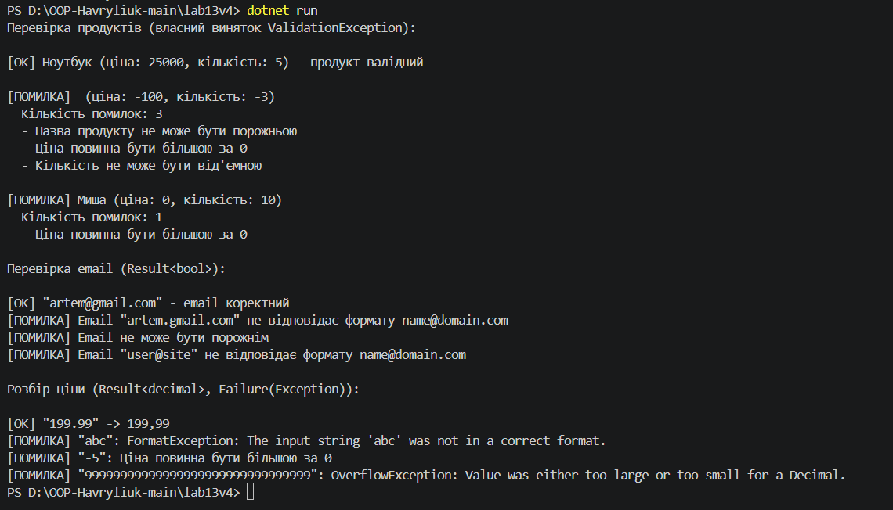

# Лабораторна робота №13: Власні винятки та патерн Result.

**Тема:** Власні винятки та патерн Result.

**Мета:** Навчитися створювати власні типи винятків для специфічних помилок, а також реалізовувати патерн Result для більш контрольованої обробки помилок без використання винятків у "нормальних" сценаріях невдачі.

## Хід роботи

За допомогою .NET CLI створено консольний проєкт lab13v4 у директорії OOP-Havryliuk. Сценарій варіанту 4 — валідація даних.

Створено клас Product з властивостями Name, Price та Quantity. Створено власний виняток ValidationException, успадкований від Exception, з властивістю List<string> Errors. У ньому реалізовано стандартні конструктори: без параметрів, з повідомленням, з повідомленням і внутрішнім винятком, конструктор для серіалізації, а також конструктор зі списком помилок, який формує повідомлення з усіх помилок.

Створено узагальнений клас Result<T> з властивостями IsSuccess, Value та Error і приватним конструктором Result(T value, bool isSuccess, string error). Об'єкт створюється лише через статичні фабричні методи Success(T value), Failure(string error) та Failure(Exception ex), який бере тип і повідомлення винятку.

Створено клас ValidatorService з трьома методами. ValidateProduct перевіряє назву (не порожня, не довша за 50 символів), ціну (більша за 0) та кількість (не від'ємна), збирає всі знайдені помилки і викидає ValidationException. IsEmailValid повертає Result<bool>: Failure, якщо email порожній або не відповідає формату name@domain.com, і Success в іншому разі. ParsePrice повертає Result<decimal>: перехоплює FormatException та OverflowException від decimal.Parse і перетворює їх на Failure(Exception), а для ціни, меншої або рівної 0, повертає Failure з текстом помилки.

У Main перевіряються 3 продукти (один валідний і два з помилками) з обробкою ValidationException у блоці try-catch-finally, 4 email-адреси та 4 рядки з ціною, результат яких обробляється через перевірку IsSuccess та Error.

## Результат виконання

## Висновок

Для ValidateProduct у моєму варіанті обрано власний виняток, бо продукт перевіряється перед збереженням, і невалідний продукт означає, що далі працювати з ним не можна. ValidationException передає всі помилки одразу через Errors, а catch (ValidationException) обробляє саме цей тип помилки окремо від інших. Для IsEmailValid і ParsePrice обрано Result<T>, бо неправильний email чи ціна, введені користувачем, — це очікувана ситуація, а не виняткова. Результат перевіряється звичайним if, код читається простіше, а програма не витрачає ресурси на створення і перехоплення винятків. Метод Failure(Exception) зручний, коли помилку кидає сторонній код, як decimal.Parse: виняток перехоплюється всередині сервісу, і викликаючий код його не бачить.

## Відповіді на контрольні питання

* **Навіщо створювати власні типи винятків? Які переваги це дає?**
  Власний виняток точно описує помилку конкретного застосунку, а не загальну ситуацію. Його можна перехопити окремим catch, не зачіпаючи інших винятків, і передати в ньому додаткові дані, як список помилок Errors у ValidationException. Код стає зрозумілішим, бо з назви винятку видно, що саме пішло не так.

* **Які стандартні конструктори рекомендується реалізовувати для власних винятків?**
  Конструктор без параметрів, конструктор з повідомленням (string message), конструктор з повідомленням і внутрішнім винятком (string message, Exception innerException) та захищений конструктор для серіалізації (SerializationInfo info, StreamingContext context). У .NET 8 і новіших конструктор для серіалізації позначено як застарілий, але його залишають для сумісності.

* **Поясніть патерн Result. У яких випадках його використання є більш доцільним, ніж викидання винятків?**
  Метод повертає об'єкт Result<T>, у якому є або успішне значення, або опис помилки, а викликаючий код перевіряє IsSuccess. Це доцільно для очікуваних невдач, які трапляються часто: неправильне введення користувача, відсутній елемент, невалідний формат даних. Так помилка стає явною частиною результату методу, і її неможливо не помітити.

* **Які сценарії краще обробляти через винятки, а які через патерн Result?**
  Через винятки — неочікувані помилки та порушення правил програми: немає з'єднання з базою, пошкоджений файл, некоректний аргумент від програміста, невалідний об'єкт перед збереженням. Через Result — передбачувані невдачі, що є частиною нормальної роботи: перевірка введених даних, пошук елемента, якого може не бути, розбір рядка в число.
