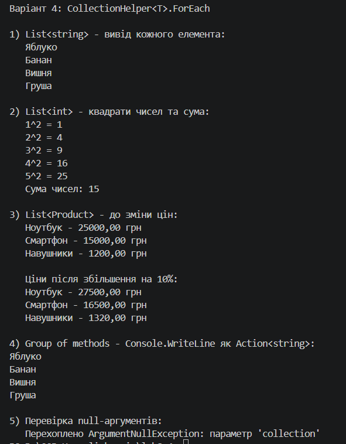

# Лабораторна робота №8: Делегати й лямбда-вирази. CollectionHelper<T>.

**Тема:** Делегати й лямбда-вирази у практиці колекцій: CollectionHelper<T>.

**Мета:** Навчитися передавати поведінку як параметр через делегати Func, Action, Predicate, будувати на цій основі універсальні операції над колекціями та використовувати лямбда-вирази у практиці ООП.

**Варіант 4:** метод `ForEach` — виконує дію `action` для кожного елемента колекції.

## Хід роботи

У ході виконання роботи за допомогою .NET CLI було створено консольний проєкт `lab14v4` у директорії `OOP-Havryliuk` (команда `dotnet new console -o OOP-Havryliuk/lab14v4`).

У проєкті реалізовано статичний узагальнений клас `CollectionHelper<T>` з методом, який відповідає варіанту 4:

```csharp
public static void ForEach(IEnumerable<T> collection, Action<T> action)
```

Метод перевіряє аргументи на `null` (викидає `ArgumentNullException`) і виконує `action` для кожного елемента власним циклом `foreach`, без використання готового `List<T>.ForEach`. Поведінка передається як параметр через делегат `Action<T>`: метод не знає, що саме буде зроблено з елементом — виводити його, змінювати чи накопичувати значення.

Для демонстрації створено власний клас `Product` (властивості `Name` та `Price`). У методі `Main` метод `ForEach` викликається для трьох колекцій різних типів:

1. `List<string>` — вивід кожного елемента в консоль.
2. `List<int>` — вивід квадрата кожного числа та підрахунок суми через замикання (лямбда змінює локальну змінну `sum`).
3. `List<Product>` — збільшення ціни кожного продукту на 10%.

Додатково показано передачу методу через групу методів (`Console.WriteLine` як `Action<string>`) та перевірку обробки `null`.

## Структура проєкту

| Файл | Призначення |
|------|-------------|
| `CollectionHelper.cs` | Статичний узагальнений клас з методом `ForEach` |
| `Product.cs` | Клас-модель для демонстрації |
| `Program.cs` | Демонстрація роботи в `Main` |

## Запуск

```bash
cd lab14v4
dotnet run
```

## Результат виконання



## Відповіді на контрольні питання

* **Що таке делегат і для чого він потрібен?**
  Делегат — це тип, який представляє посилання на метод із певною сигнатурою (параметри та тип результату). Він дозволяє передавати методи як параметри, зберігати їх у змінних та викликати пізніше, що робить код гнучким: логіка обробки визначається не всередині методу, а під час його виклику.

* **Яка різниця між Func, Action та Predicate?**
  `Func<T, TResult>` приймає параметри та повертає значення; `Action<T>` приймає параметри, але нічого не повертає (`void`); `Predicate<T>` приймає один параметр і повертає `bool`. У цій роботі використано `Action<T>`, бо `ForEach` лише виконує дію над елементом і не повертає результат.

* **Що таке лямбда-вираз і чим він відрізняється від анонімного методу?**
  Лямбда-вираз — компактний синтаксис анонімної функції (`x => x * x`). Анонімний метод (`delegate (int x) { return x * x; }`) робить те саме, але має довший запис. Лямбда-вирази можуть мати «виразне» тіло без `return` і зазвичай мають коротший синтаксис, виведення типів параметрів компілятором.

* **Що таке замикання (closure)?**
  Замикання — це ситуація, коли лямбда-вираз «захоплює» локальні змінні зовнішнього методу й може читати та змінювати їх. У прикладі лямбда додає елементи до змінної `sum`, оголошеної поза нею.

* **Чому метод ForEach зроблено узагальненим і приймає `IEnumerable<T>`?**
  Узагальнення (`T`) дозволяє використовувати один і той самий код для `List<int>`, `List<string>`, `List<Product>` без дублювання й без приведення типів. Параметр `IEnumerable<T>` робить метод універсальним для будь-якої колекції, яку можна перебрати через `foreach` (масив, список, множина тощо).
