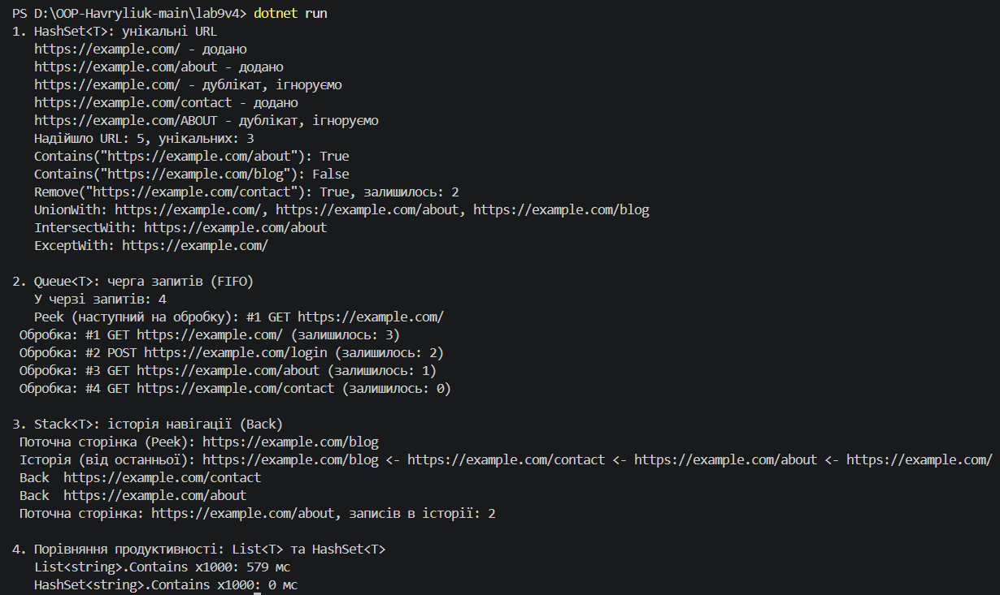

# Лабораторна робота №9: HashSet/Queue/Stack. Практичні сценарії.

**Тема:** HashSet/Queue/Stack: практичні сценарії.

**Мета:** Навчитися використовувати спеціалізовані колекції `HashSet<T>`, `Queue<T>`, `Stack<T>` для розв'язання практичних задач, зрозуміти їхні особливості та сценарії застосування.

## Хід роботи

У ході виконання роботи за допомогою .NET CLI було створено консольний проєкт `lab9v4` у директорії `OOP-Havryliuk` (команда `dotnet new console -o OOP-Havryliuk/lab9v4`).

Для представлення даних створено клас `PageRequest` (властивості `Id`, `Method`, `Url`).

`UrlRegistry` приймає URL, відкидає дублікати та не розрізняє регістр (`StringComparer.OrdinalIgnoreCase`), тому `/about` та `/ABOUT` вважаються одним URL. `RequestQueue` обробляє запити строго в порядку надходження. `NavigationHistory` зберігає відвідані сторінки, а метод `Back()` видаляє з вершини поточну сторінку й повертає попередню.

У методі `Main` виконано всі основні операції для кожної колекції та додатково порівняно швидкість пошуку `List<string>.Contains` і `HashSet<string>.Contains` на 100 000 елементів.

## Результат виконання

## Відповіді на контрольні питання

* **У чому різниця між `List<T>` та `HashSet<T>`?**
  `List<T>` зберігає елементи в порядку додавання, допускає дублікати та доступ за індексом, але пошук `Contains` перебирає елементи по черзі (O(n)). `HashSet<T>` зберігає лише унікальні елементи без гарантованого порядку, не має індексів, зате перевіряє наявність елемента в середньому за O(1).

* **Коли доцільно використовувати `Queue<T>` замість `List<T>`?**
  Коли елементи потрібно обробляти строго в порядку надходження (FIFO): черга завдань, запитів, подій. `Queue<T>` швидко додає в кінець і забирає з початку, а видалення першого елемента зі `List<T>` (`RemoveAt(0)`) зсуває всі інші елементи й коштує O(n).

* **Наведіть приклад реальної задачі, де потрібен `Stack<T>`.**
  Кнопка «Назад» у браузері (історія навігації, як у цій роботі), скасування дій (Undo/Redo) у редакторах, перевірка збалансованості дужок, обхід дерева в глибину (DFS).

* **Яка складність операції `Contains()` для `HashSet<T>` і чому?**
  У середньому O(1). `HashSet<T>` обчислює хеш-код елемента, за ним одразу знаходить комірку (кошик) у хеш-таблиці й порівнює елемент лише з тими, що опинилися в цій комірці, а не з усіма. У найгіршому випадку (багато колізій) складність може деградувати до O(n).

* **Чому `Queue<T>` називають FIFO, а `Stack<T>` - LIFO?**
  `Queue<T>` — First In, First Out: елемент, доданий першим (`Enqueue`), першим і виходить (`Dequeue`), як черга в магазині. `Stack<T>` — Last In, First Out: елемент, доданий останнім (`Push`), першим і знімається (`Pop`), як стопка тарілок.
